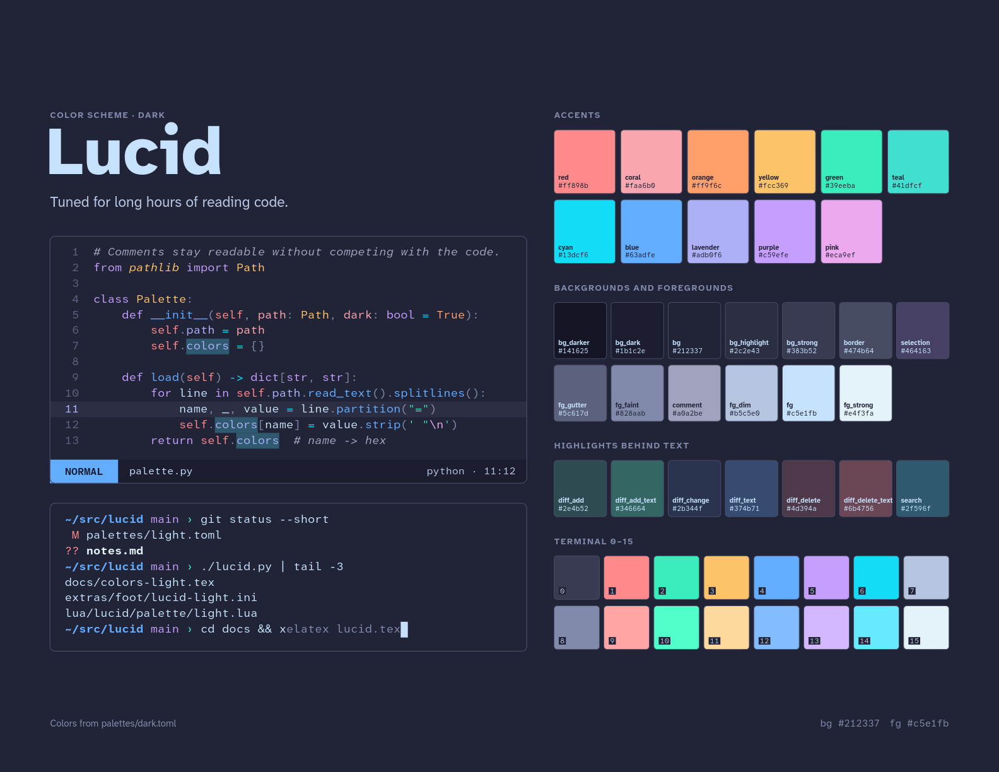
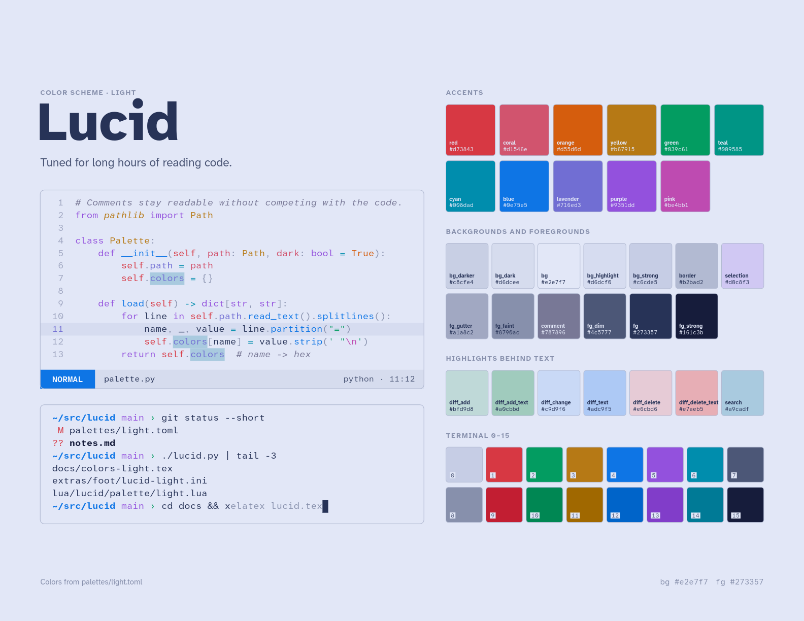

# Lucid Colorscheme

This is my colorscheme based off of [shaunsingh's moonlight.nvim](https://github.com/shaunsingh/moonlight.nvim), which has been my preferred colorscheme for the last few years.
I've tweaked the colors to give them a bit more contrast against the background color and added a light theme that's at least vaguely reminiscent of the same vibe.

The goal here is easy reading and I think I've managed that.

## Palettes

### Dark Palette


### Light Palette


## Repo Setup

The base of this repo is intended to work as a Neovim plugin, but all colors will be driven by global palette files `palettes/{dark.toml,light.toml}` that can be used to generate colorscheme configs for other programs.

```
.
├── palettes
│   ├── dark.toml                       # dark theme global palette
│   └── light.toml                      # light theme global palette
├── lucid.py                            # script to generate colorscheme configs from palettes
├── templates                           # templates for each different program's colorscheme files
│   ├── docs
│   │   └── colors-{{variant}}.tex      # template for the LaTeX palette doc
│   └── lua                             # Neovim config template
│       └── lucid
│           └── palette
│               └── {{variant}}.lua
├── lua                                 # the Neovim plugin configs
│   ├── lualine
│   │   └── themes
│   │       └── lucid.lua
│   └── lucid
│       ├── init.lua                    # entrypoint
│       ├── groups.lua                  # sets up highlight groups
│       ├── palette                     # the palettes generated from the templates
│       │   ├── dark.lua
│       │   └── light.lua
│       └── plugins                     # configs for plugins that need extra setup 
│           ├── blink.lua
│           ├── bufferline.lua
│           ├── gitsigns.lua
│           ├── indent_blankline.lua
│           ├── markview.lua
│           ├── mini_icons.lua
│           ├── snacks.lua
│           ├── trouble.lua
│           └── which_key.lua
├── colors                              # plugin loading colorscheme setting
│   └── lucid.lua
├── docs                                # palette colorscheme doc
│   ├── colors-dark.tex
│   ├── colors-light.tex
│   ├── lucid-dark.png
│   ├── lucid-light.png
│   ├── lucid.pdf
│   └── lucid.tex
└── README.md                           # you are here

```

Files generated by `lucid.py` are committed, so a fresh clone still contains the fully working colorscheme.
Change these by editing the `palette/<variant>.toml` file and run `lucid.py`.

TODO: Setup a workflow to regenerate on push to GitHub

## Programs
### Neovim

With `lazy.nvim`:

*Note: I have no actual idea if this works, I don't use `lazy.nvim`*

```lua
{ dir = "jblocklove/lucid-colorscheme", priority = 1000,
  config = function() vim.cmd.colorscheme("lucid") end }
```

**Dark or light:** lucid follows Neovim's `background` option.
Neovim sets it from the terminal's background color when it starts, so in a light terminal window you get the light theme without configuring anything (assuming the colorscheme provides that information).
To switch in a running Neovim, `:set background=light` (or `dark`); lualine follows.
To always use one, set `vim.o.background` before the `colorscheme` line.

**Changing highlights:** Everything is in `lua/lucid/groups.lua`, written for both variants.
Edit it and run `:colorscheme lucid` to see the change without restarting.
`:Inspect` shows which groups apply to the text under the cursor.

Neovim already links treesitter and LSP groups to the classic ones, and most plugins link theirs to core groups like `NormalFloat`, `Pmenu` and `Added`/`Changed`/`Removed`.
There's some extra TreeSitter configs in `groups.lua` for things that aren't covered.

#### Plugins

Plugins that need more than the core groups get a file in `lua/lucid/plugins/`.
Every file there is loaded automatically; there's nothing to configure, and a file for a plugin you don't use does no harm.
Each file starts with a comment saying what goes wrong without it.

| Plugin | What lucid adds |
|---|---|
| blink.cmp | Highlighting for matched characters (blink uses a group it never defines); kind icons in the colors of the syntax they stand for; borders in the border color |
| bufferline.nvim | All its groups, matching lucid's tab line (keep bufferline's `themable` option on, the default) |
| fidget.nvim | Nothing needed; it uses `Title`, `Question`, `WarningMsg` and friends |
| gitsigns.nvim | Backgrounds for changed words in word diff and inline previews, which otherwise show in reverse video |
| indent-blankline.nvim | Quieter guides and a brighter current scope |
| lualine.nvim | A theme: `options = { theme = "lucid" }` |
| markview.nvim | A color per heading level, which markview also uses for callouts and checkboxes |
| snacks.nvim | Indent guides like ibl's, picker matches in the completion menu's blue, dashboard colors |
| trouble.nvim | Text and file icons without the editor background showing through its window |
| which-key.nvim | Icon colors that match their names |
| mini.icons | The same icon fix, for which-key and snacks when they get icons from it |

`groups.lua` also gives markdown headings a color per level (red, orange, yellow, green, blue, purple), dims `PmenuKind` and `PmenuExtra` (the kind and detail columns of completion menus), and sets `NonText` to `fg_faint`, since many plugins use it for secondary text like directory names and git blame.

**Adding a plugin.** Open something the plugin draws and run `:Inspect` on it, or list its groups with `:highlight` plus the group prefix (for example, `:highlight Neogit`, then press Tab).
Then create `lua/lucid/plugins/<name>.lua`:

```lua
-- neogit example
return function(c)
	return {
		NeogitBranch = { fg = c.blue, bold = true },
		NeogitRemote = { link = "Comment" },
	}
end
```

and run `:colorscheme lucid`.
Linking to existing groups (`@function`, `Comment`, `FloatBorder`) keeps a plugin in step with the rest of the theme.
One thing to watch for: a group that links to `Normal` carries the editor background, which shows as a block inside floating windows; give such groups an `fg` only.

## Changing a color

1. Edit `palettes/dark.toml` or `palettes/light.toml`.
    Both use the same names, and each name does the same job in both, so a new color goes in both files.
2. Run `./lucid.py` (Python 3.11+).
3. Neovim: `:colorscheme lucid`

## Adding a program

1. Write the program's color config as a template under `templates/`.
    Where a color goes, write `{{name}}` for `#rrggbb`, `{{name.hex}}` for `rrggbb`, or `{{name.rgb}}` for `r, g, b` (for `rgba(…)` colors with transparency, as the zathura template does).
    Names are anything in `[colors]`, plus `foreground`, `background`, `selection_fg`, `selection_bg` and `color0`–`color15` from `[terminal]`.
   - Most programs take one variant per file. Put `{{variant}}` in the file name and you get one copy per palette, like `templates/extras/neomutt/lucid-{{variant}}.muttrc`. Inside the file, `{{variant}}` is `dark` or `light`.
   - Programs that hold both variants in one file, like Noctalia, get a template without `{{variant}}` in the name. Inside, prefix each name with the palette: `{{dark.bg}}`, `{{light.bg.hex}}`. See `templates/extras/noctalia/Lucid.json`.
2. Run `./lucid.py`. The output appears at the same path without the
   `templates/` prefix.
3. Load it from the program's own config, the way the sections above do.

The existing templates in `templates/extras/` are short and make good starting points.
Programs that only use the terminal's 16 colors, such as `ls` and `git`, already follow foot's palette, including when foot switches variant, and need no template.

## Palette Docs

```sh
./lucid.py
cd docs && xelatex lucid.tex     # or lualatex
```

`docs/lucid.tex` draws one page per palette: it loads `colors-dark.tex`, draws the page, then loads `colors-light.tex` and draws it again. Needs a TeXLive with tikz, fontspec, fancyvrb and eso-pic. It uses Atkinson Hyperlegible Next and Mono when installed (free on Google Fonts) and falls back to Inter, JetBrains Mono or DejaVu.
